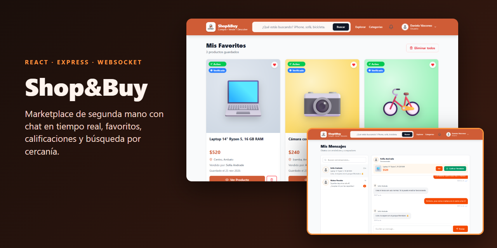
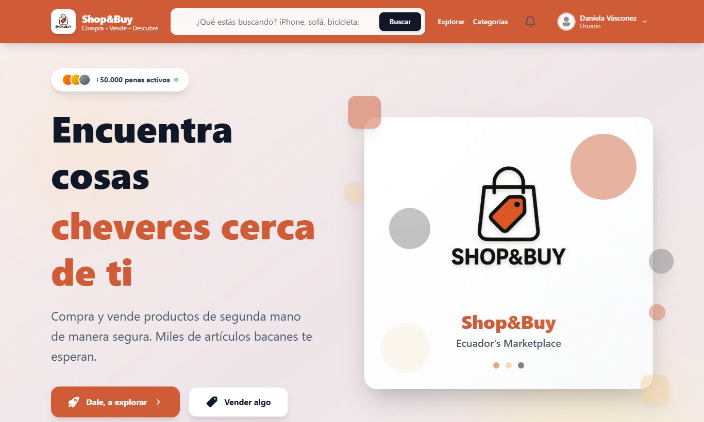
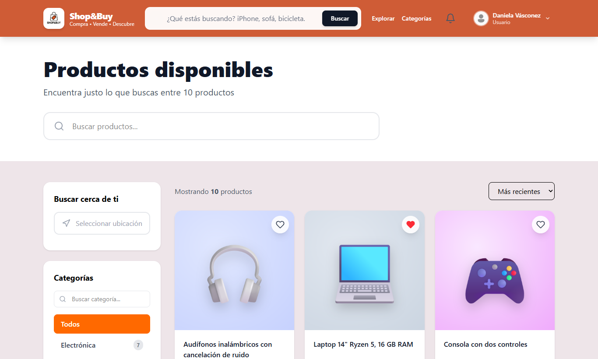
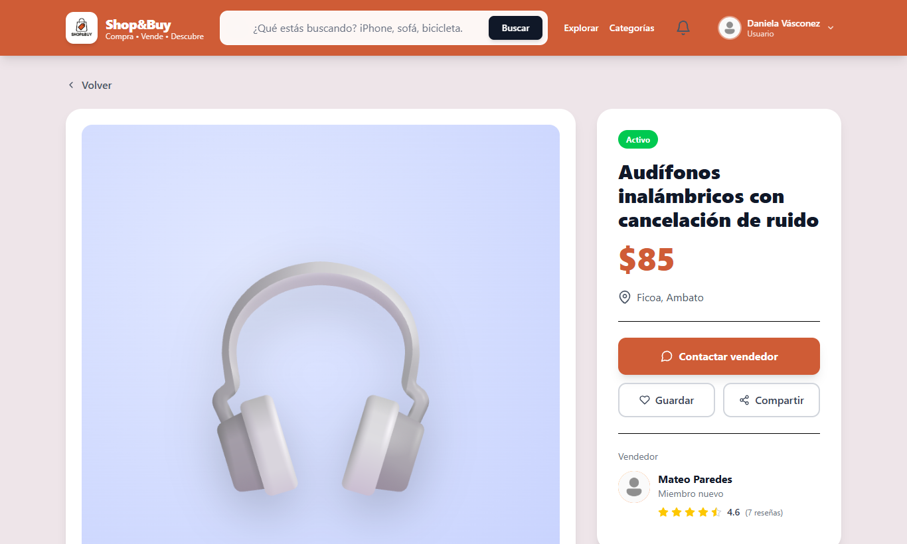
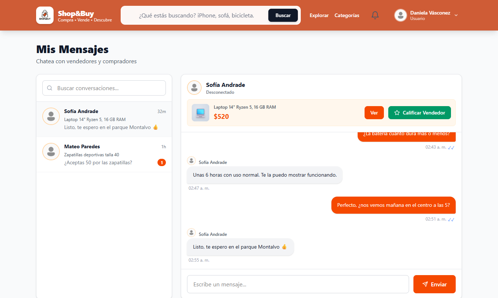

# Shop&Buy · Frontend del marketplace (Web y Móviles)

Interfaz web de **Shop&Buy**, un marketplace de compra y venta de segunda mano: catálogo con filtros por
categoría y cercanía, detalle de producto con mapa, publicación con fotos, favoritos, calificación de
vendedores y chat en tiempo real entre comprador y vendedor. Proyecto de la asignatura **Aplicaciones Web y
Móviles** (2025); la API está en
[Proyecto-Web-y-Moviles---Backend](https://github.com/Jostero32/Proyecto-Web-y-Moviles---Backend).

**Stack:** React 19 · Vite · Tailwind CSS 4 · React Router 7 · Axios · Leaflet · WebSocket



| Inicio | Productos | Detalle | Chat |
|---|---|---|---|
|  |  |  |  |

<sub>Capturas con datos de demostración inventados.</sub>

## Funcionalidades

- **Catálogo:** búsqueda, categorías y subcategorías, orden y filtro por ubicación.
- **Productos:** detalle con fotos y mapa, compartir enlace, publicar y editar con fotos.
- **Cuenta:** registro con validación de cédula, verificación por correo, perfil y avatar.
- **Comunidad:** favoritos, calificación de vendedores y notificaciones.
- **Chat en tiempo real** por WebSocket, con estado de lectura de los mensajes.

## Ejecutar

Necesita el backend corriendo (por defecto en `http://localhost:8080`).

```bash
cp .env.example .env      # VITE_API_URL apunta al backend
npm install
npm run dev               # http://localhost:5173
```

Con Docker:

```bash
docker build -t shopandbuy-front .
docker run --rm -p 5173:5173 -e VITE_API_URL=http://localhost:8080 shopandbuy-front
```

## Estructura

```
src/
├── pages/        Inicio, productos, detalle, vender, chat, favoritos, perfil, notificaciones…
├── components/   Componentes compartidos (selector de ubicación, calificación, estado de mensajes)
├── contexts/     Notificaciones en tiempo real
├── services/     Cliente HTTP (Axios) y manejo de la sesión en cookies
└── config/       Configuración del WebSocket
```

## Equipo

Frontend desarrollado principalmente por [3lJonas](https://github.com/3lJonas) y
[Reclax](https://github.com/Reclax); backend por [Jostero32](https://github.com/Jostero32).
